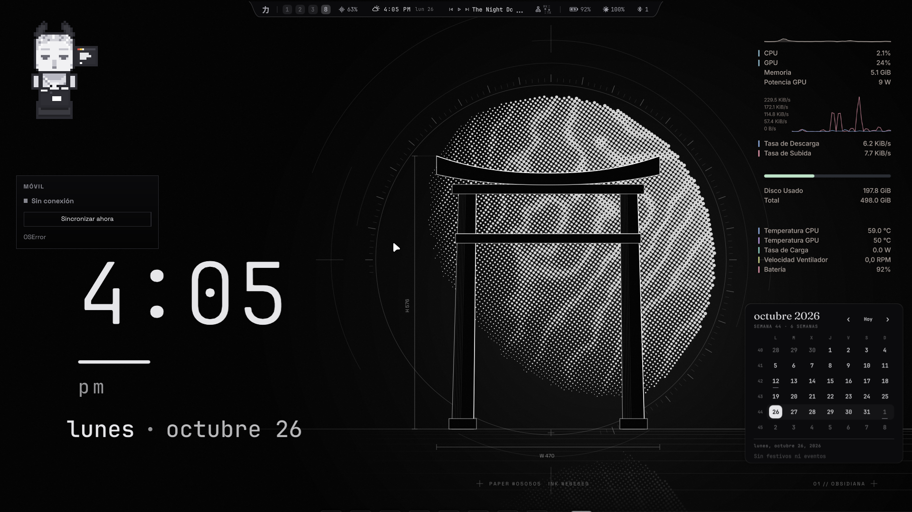
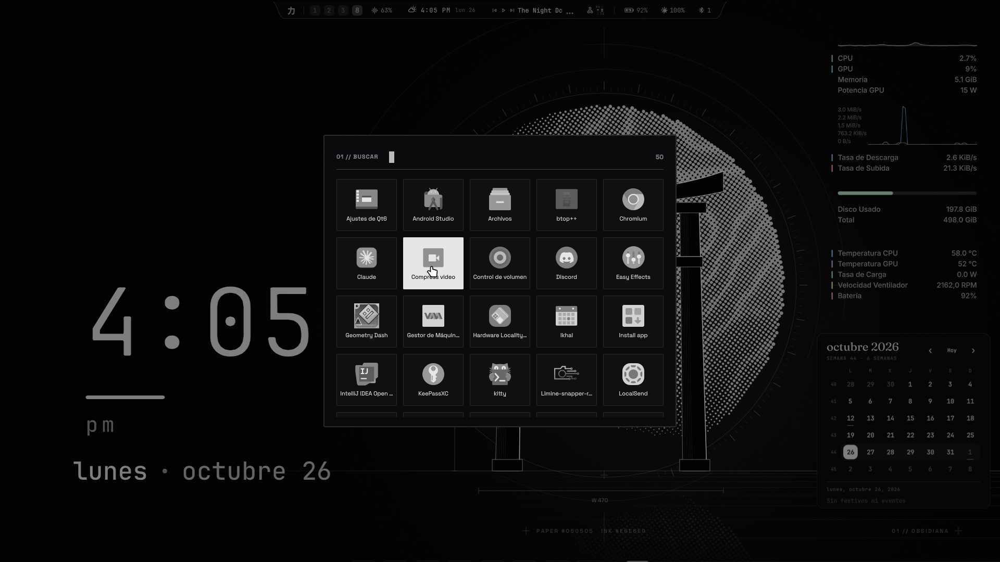
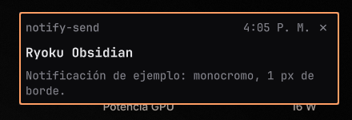
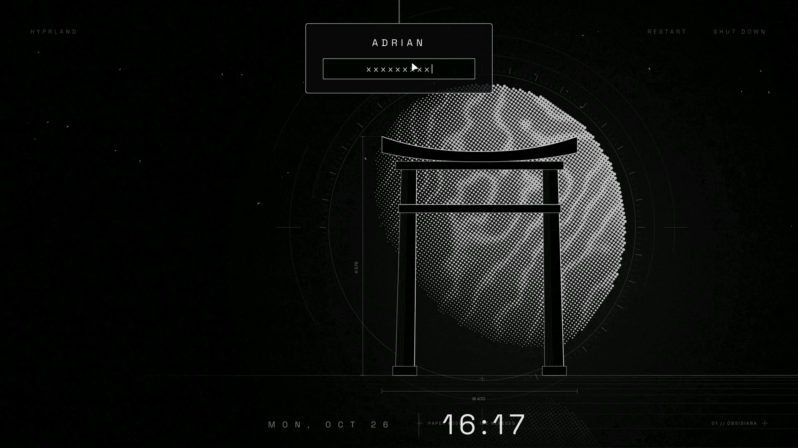
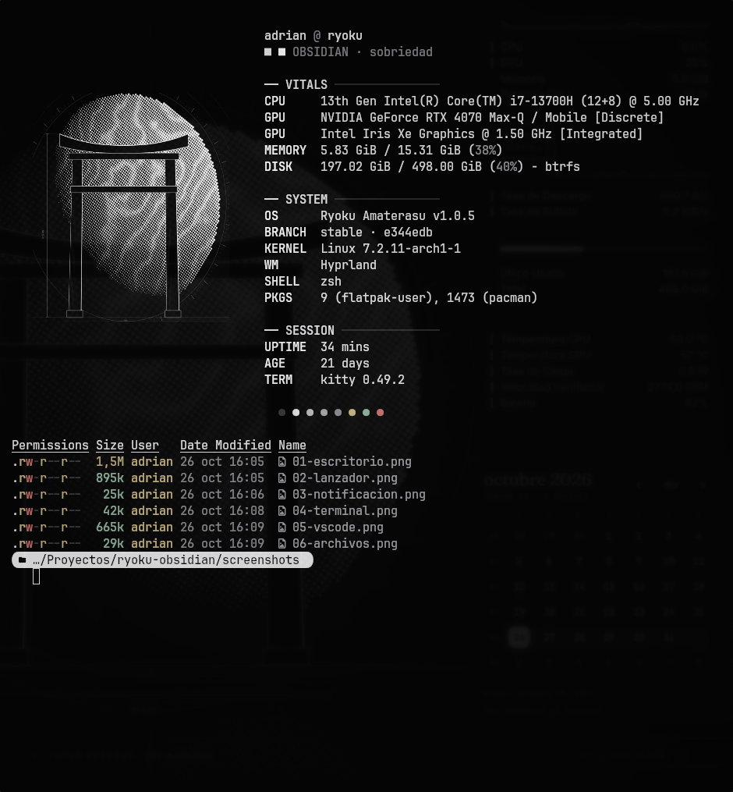
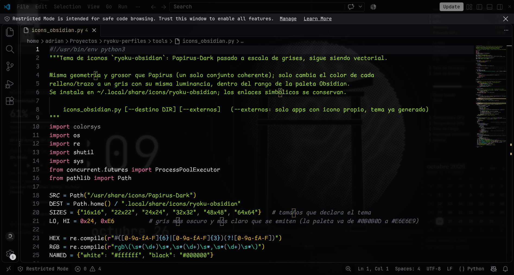
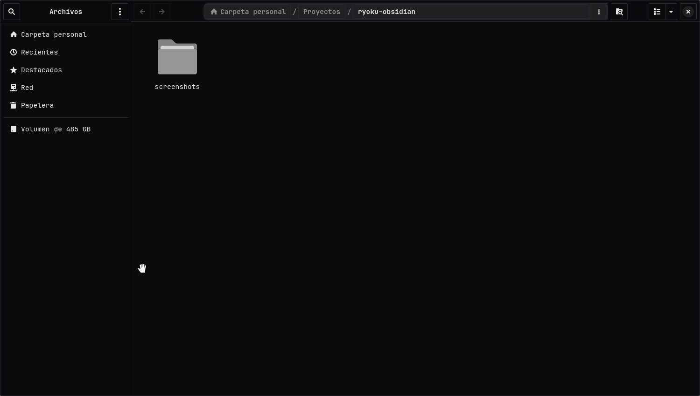
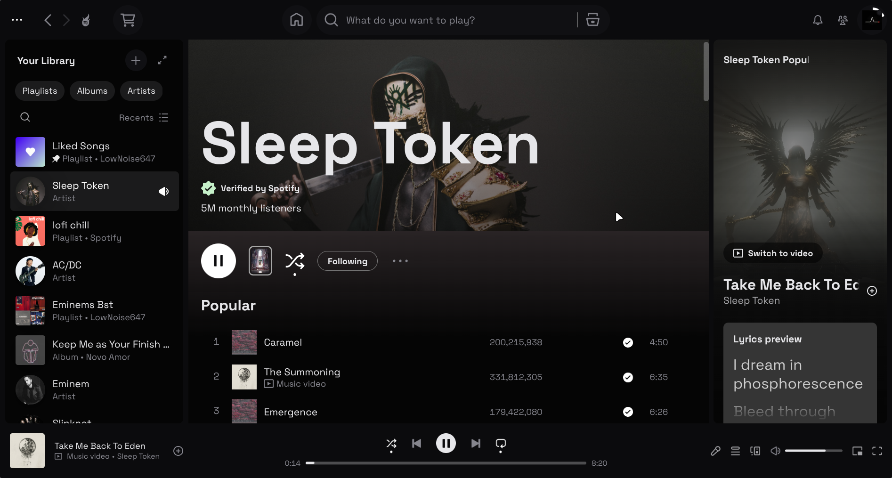
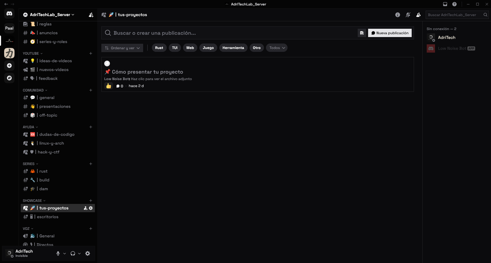
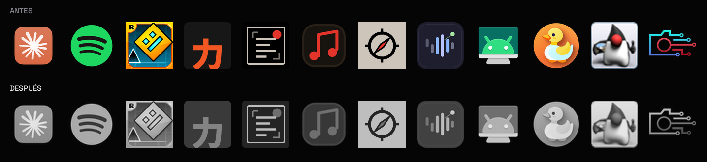

# Ryoku Obsidian

Perfil monocromo para [Ryoku](https://github.com/ryoku-dev/ryoku) (Arch + Hyprland + Quickshell): obsidiana casi negra, blanco y gris, bordes de 1 px, Space Grotesk. Todo el arte es propio y se genera por código.



## Qué incluye

| | |
|---|---|
| **Fondo y paleta** | disco de semitono con torii y cotas (`tools/obsidian_scene.py`); 30 roles + 16 colores, solo grises |
| **Lanzador** | estilo propio `launcher/perfil/StyleObsidian.qml` |
| **Iconos** | Papirus-Dark en grises (`tools/icons_obsidian.py`), incluidas las apps con icono propio |
| **Bloqueo** | tema qylock `pixel-obsidian` (`tools/lockscreen_obsidian.py`) |
| **Terminal** | kitty, starship y fastfetch con el emblema del perfil |
| **Apps** | VS Code, Spotify, Discord, Zen, Obsidian y Qt (`apps/`) |

| Lanzador | Notificación |
|---|---|
|  |  |

| Bloqueo | Terminal |
|---|---|
|  |  |

| VS Code (UI gris, código a color) | Archivos |
|---|---|
|  |  |

| Spotify | Discord |
|---|---|
|  |  |

**Iconos con color propio, antes y después**



## Instalar

Requiere [`ryoku-perfiles`](docs/ARCHITECTURE.md) (herramienta `perfil`). Copia estos ficheros a ese repo respetando las rutas y:

```sh
perfil build obsidian && perfil apply obsidian      # fondo, paleta, kitty, fastfetch, plugins
python3 tools/icons_obsidian.py                      # tema de iconos (una vez)
python3 tools/lockscreen_obsidian.py                 # tema de bloqueo
ryoku-hub lock set pixel-obsidian                    # pide pkexec
bash launcher/install.sh --activar                   # lanzador
bash apps/instalar_apps.sh                           # Zen, VS Code, Spotify, Discord
```

Cambios en el núcleo de `ryoku-perfiles` que el perfil necesita: añadir `obsidian: "Obsidian"` al mapa `styles` de `launcher/perfil/Main.qml` (sin él el lanzador cae a Kami) y la función `set_plugins` de `perfil` (reactiva los plugins tras `rice apply`). Detalle en [`docs/APPS.md`](docs/APPS.md) y [`docs/VALIDATION.md`](docs/VALIDATION.md).

Volver atrás: `perfil apply <otro>` (VS Code, Spotify, Discord y Zen no vuelven solos; ver `docs/APPS.md`).

## Límites

- **Discord** se tematiza inyectando CSS por el puerto de depuración (`127.0.0.1:9223`). Modificar el cliente va contra los términos de Discord; riesgo bajo, no cero.
- Zen y Obsidian llevan su tema (`apps/zen`, `apps/obsidian`) pero no tienen captura: sus ventanas muestran pestañas y notas personales.
- Quedan colores fijos del shell (marcas de estadísticas, barra del disco, borde de notificaciones): no se tocan para no romper Ryoku.
- Probado en Hyprland 0.56, Quickshell 0.3.2, Ryoku Amaterasu v1.0.5, 1920×1080.

## Créditos

Papirus (GPL-3.0) y qylock (GPL-3.0) como base de iconos y bloqueo, generados en local, no incluidos. Space Grotesk (SIL OFL). Sin licencia propia todavía.
